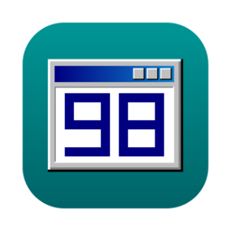
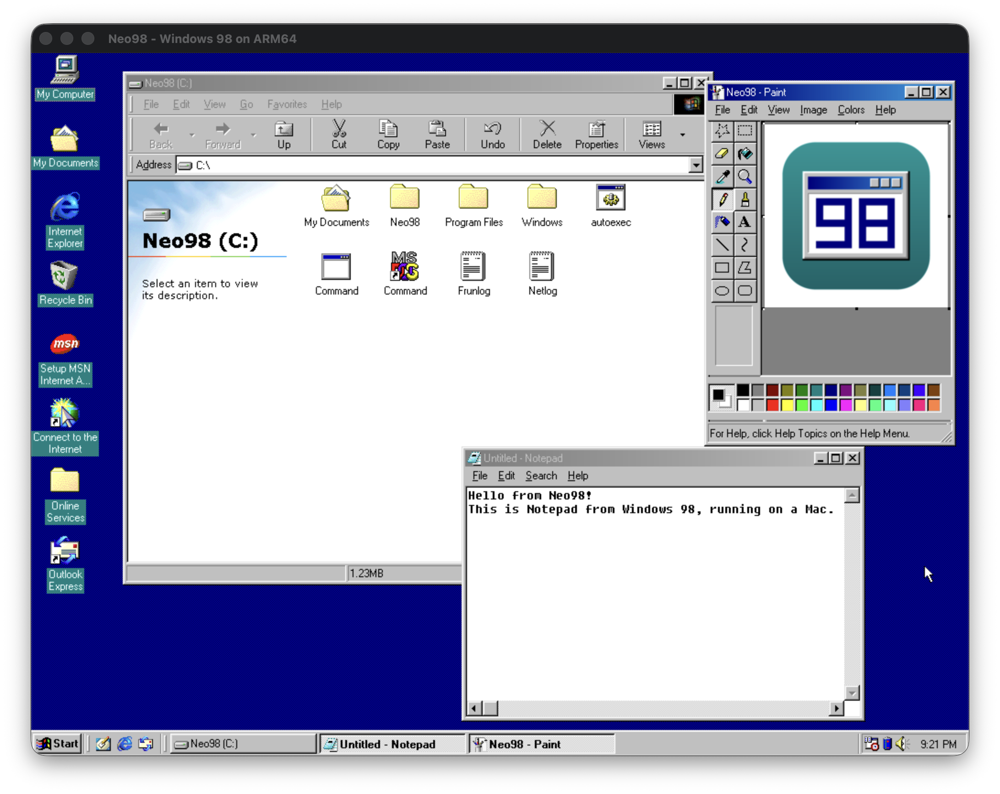
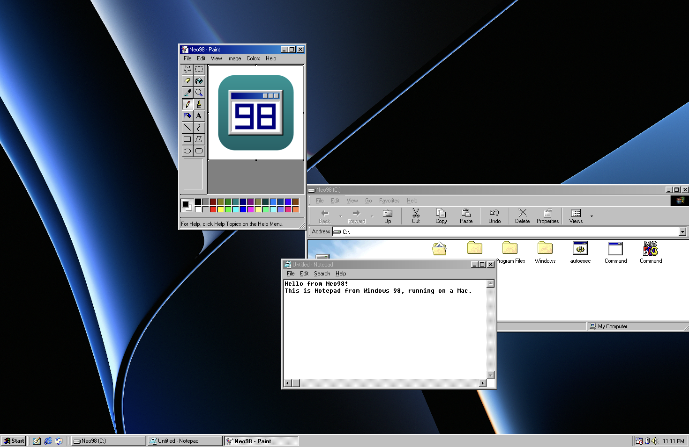
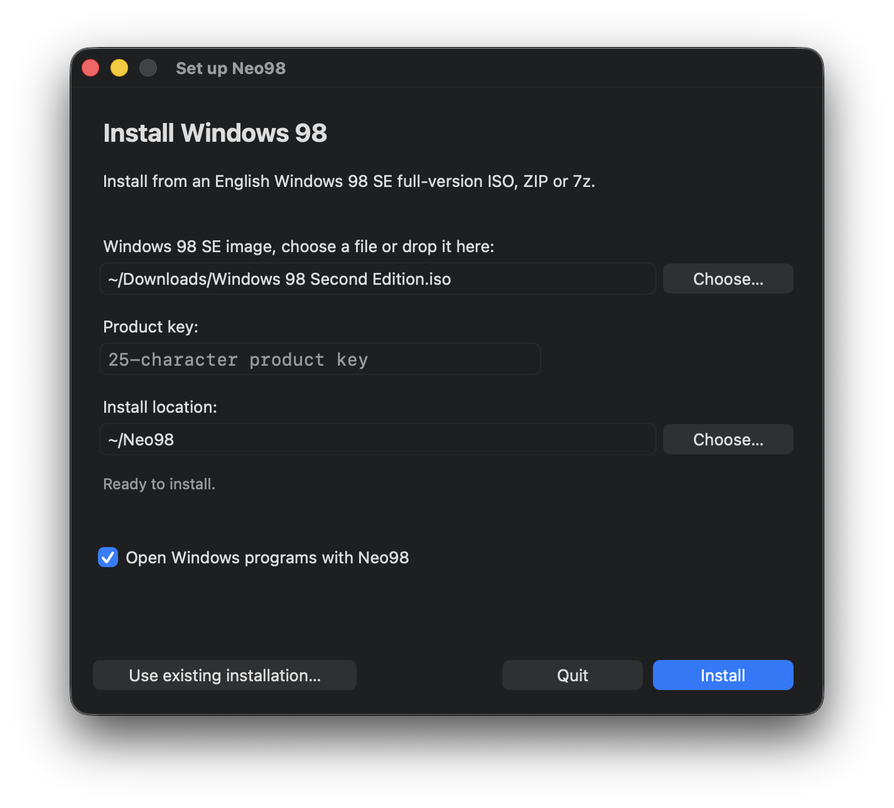
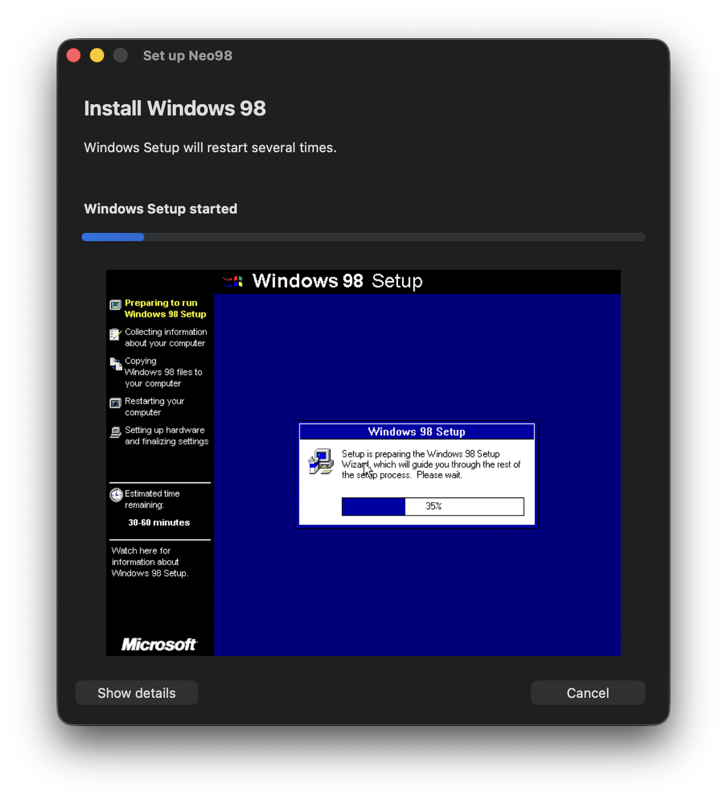
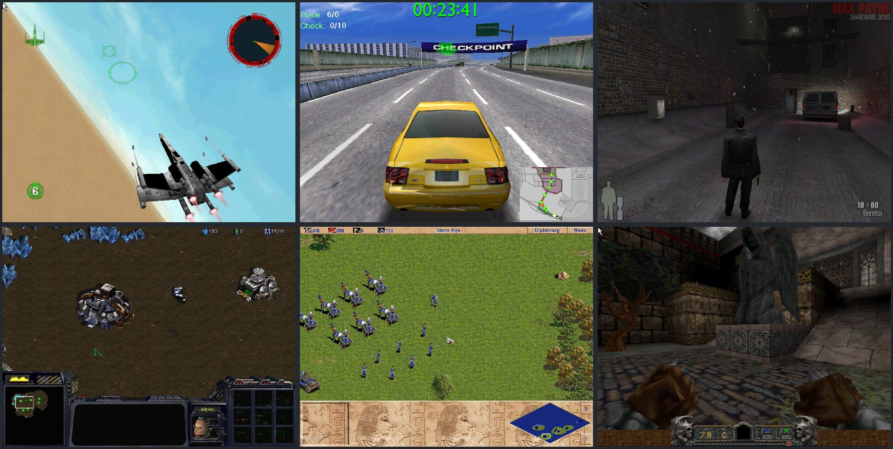

<p align="center"></p>

<h1 align="center">Neo98</h1>

<p align="center">Windows 98 programs and games on your Apple Silicon Mac and on Linux.</p>

<p align="center"><a href="https://github.com/horvath456/neo98/releases/latest"><b>Download</b></a> · <a href="#getting-started">Getting started</a> · <a href="#building-from-source">Building from source</a></p>



Neo98 brings the software of the late 90s back to your Mac. You install your old Windows 98 CD once. After that, Explorer, Paint and the games you played back then start with a double-click, right next to your Mac apps. There's a version for Linux PCs too.

Neo98 doesn't boot Windows in a virtual PC. It brings its own implementation of the core of Windows, written for today's systems. On the Mac it translates each program's x86 code to ARM while it runs; on a Linux PC the code runs directly on the processor. The rest of Windows, from Explorer to the file dialogs, comes from your own CD and runs unchanged, so everything looks and behaves the way you remember it.

In seamless mode, the Windows desktop steps aside and the programs sit right on your Mac desktop, each in its own window:



The project is young. Plenty of programs already work, some don't yet. If you run into one that doesn't, please [let me know](#when-something-doesnt-work).

## What it can do

- The Windows 98 desktop with Explorer, Start menu and taskbar, in a window or in fullscreen
- Seamless mode, where every Windows program gets its own Mac window
- Open `.exe` files and CD images straight from Finder
- 3D games that use Direct3D 5 to 9, DirectDraw, OpenGL or 3dfx Glide
- DOS games and programs, through DOSBox Pure
- Sound, game controllers and the Mac's microphone
- Copy and paste between Windows programs and Mac apps
- Internet access for Windows programs
- Game machines, which give a game its own window and its own copy of its files, and let you save the game's state at any moment

## What you need

- A Mac with Apple Silicon (M1 or newer) and macOS 13 or later, with [Homebrew](https://brew.sh) for the tools that run the one-time Windows installation
- or a 64-bit x86 PC with Linux 5.11 or newer and a desktop with X11 or XWayland. Neo98 is tested on Ubuntu 24.04; for 3D games you need a Vulkan driver.
- A Windows 98 Second Edition CD image in English. It has to be the full version, not the upgrade. An `.iso` file works, and so does an `.iso` inside a `.zip` or `.7z` archive.
- The product key that came with your copy of Windows
- About 2 GB of free disk space

Neo98 contains no Microsoft software. Setup takes everything it needs from your CD image.

## Getting started

**1. Install the setup tools.** Neo98 installs Windows 98 with the help of QEMU and a few small tools. Open Terminal and run:

```sh
brew install qemu mtools cabextract tesseract
```

**2. Install Neo98.** Download `Neo98.dmg` from the [latest release](https://github.com/horvath456/neo98/releases/latest), open it and drag Neo98 into your Applications folder.

**3. Open Neo98.** The first time, macOS asks whether you really want to open an app from the internet. Click **Open**.

**4. Install Windows 98.** The setup assistant appears. Choose your CD image, type in your product key and click **Install**.

<p align="center"></p>

**5. Let Windows Setup run.** Setup now runs by itself, and you can watch along in the window. Windows restarts a few times on the way. The whole thing takes about 20 minutes.

<p align="center"></p>

When Setup is done, the Windows 98 desktop appears. From now on, Neo98 starts right there.

### On Linux

Download `Neo98-linux-x64.tar.gz` from the [latest release](https://github.com/horvath456/neo98/releases/latest) and unpack it. The package brings everything the setup needs, QEMU included.

```sh
tar xzf Neo98-linux-x64.tar.gz
NEO98.AppDir/AppRun                    # opens the setup the first time
NEO98.AppDir/AppRun --install-launcher # optional: adds Neo98 to your app menu
```

Setup works the same way as on the Mac: choose your CD image, type in your product key, and Windows installs itself. The package needs a glibc at least as new as Ubuntu 24.04's.

## Using Neo98

**Starting programs.** Double-click a Windows program in Finder, or choose **File → Open program…** in Neo98. The Start menu works too, just like on a real PC.

**Your files.** Drive C: is an ordinary folder on your Mac, `Neo98/C` in your home folder. Copy programs and files into it with Finder. **Machine → Choose drive D:…** turns any Mac folder into drive D:.

**CDs.** Many games want their CD in the drive. Choose **Machine → Mount ISO or folder as CD-ROM…**, or double-click the CD image in Finder.

**Seamless mode.** **View → Seamless** hides the Windows desktop and puts every program in its own Mac window.

**Game machines.** When you open a game from Finder, Neo98 asks whether to run it normally or in a game machine. A game machine has its own window and keeps the game's files, settings and saves apart from your other programs. **Machine → Save state** (Shift-Command-S) freezes the game exactly where it is, and you can continue from there later.

**The mouse.** Some games capture the mouse pointer. Press Control-Option to get it back.

## Games

Neo98 is tested with a collection of game demos and shareware releases from the late 90s and early 2000s. Here are a few of them:



## When something doesn't work

Not every program runs yet, and some run with glitches. If you find one, please [open an issue](https://github.com/horvath456/neo98/issues). Say which program it is, where it came from and what happened. If Neo98 wrote a crash report, attach it; you'll find them in `~/Library/Logs/Neo98/crash-reports`. Please don't attach Windows files or your product key.

Some limits you should know about:

- Only the English Windows 98 Second Edition CD can be installed for now.
- Saving a game's state doesn't work in every situation yet.
- The Linux version is newer than the Mac version and has seen fewer programs so far. Its shortcuts differ: Ctrl+Shift+M opens the machine menu, Ctrl+Shift+S switches seamless mode and F11 fullscreen.

## Questions

**How is this different from a virtual machine like 86Box, PCem or UTM?** Those emulate a whole PC and boot Windows on it. Neo98 runs Windows programs directly, as apps on your Mac or Linux desktop, without a virtual PC in between. That makes it fast and lets Windows programs share your desktop, clipboard and files.

**And from Wine?** Wine reimplements all of Windows from scratch and focuses on newer programs. Neo98 uses your own Windows 98, so everything from Explorer to the dialogs is the real thing from 1999, and it is made for the programs and games of that time.

**Do I need my own Windows?** Yes. Neo98 contains no Microsoft software. You need a Windows 98 SE CD image and the product key that came with it.

**Which games run?** Many, including 3D games through Direct3D, OpenGL and 3dfx Glide, and DOS games. See [Games](#games) for a few examples, and please [tell me](https://github.com/horvath456/neo98/issues) about the ones that don't work.

## Building from source

You need the Xcode Command Line Tools and a few packages from Homebrew:

```sh
brew install llvm lld cmake ninja pkg-config sdl2 qemu mtools cabextract tesseract
git clone https://github.com/horvath456/neo98.git
cd neo98
python3 neo98.py app
```

This builds `build/Neo98.app`. The first build fetches and compiles a few dependencies, so give it some time.

[docs/BUILDING.md](docs/BUILDING.md) has the details, including the Linux version and running Neo98 from the command line. [ARCHITECTURE.md](ARCHITECTURE.md) explains how Neo98 works inside, and [docs/ARM64-APPS.md](docs/ARM64-APPS.md) shows how to write native ARM64 programs for it.

## License

Neo98 is free software under the GNU General Public License, version 2 or (at your option) any later version. See [COPYING](COPYING).

Neo98 builds on the work of other open source projects; [THIRD_PARTY.md](THIRD_PARTY.md) lists them. Every release comes with the source code of the GPL components inside the app.

Neo98 is an independent project and isn't affiliated with Microsoft, which owns the Windows trademark.
